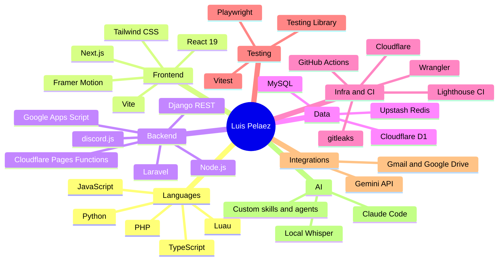

<picture><source media="(prefers-color-scheme: dark)" srcset="assets/header-dark.svg"></picture>

<picture><source media="(prefers-color-scheme: dark)" srcset="assets/divider-dark.svg"></picture>

## What I do

I build and ship full-stack web projects end to end: UI, API, database, deploy and the automated checks around them. Most of my recent work is TypeScript on Next.js and Cloudflare, with PHP/Laravel and Python where the job calls for it. I use Claude Code daily, with my own skills and agents, and ship through pull requests and CI.

## My deck

<picture><source media="(prefers-color-scheme: dark)" srcset="assets/deck-languages-dark.svg"></picture>
<picture><source media="(prefers-color-scheme: dark)" srcset="assets/deck-frontend-dark.svg"></picture>
<picture><source media="(prefers-color-scheme: dark)" srcset="assets/deck-backend-dark.svg"></picture>
<picture><source media="(prefers-color-scheme: dark)" srcset="assets/deck-data-dark.svg"></picture>
<picture><source media="(prefers-color-scheme: dark)" srcset="assets/deck-tooling-dark.svg"></picture>

Full map

Same list as text:

- **Languages:** TypeScript, JavaScript, Python, PHP, Luau
- **Frontend:** React 19, Next.js, Tailwind CSS, Vite, Framer Motion
- **Backend:** Node.js, Laravel, Django REST, Cloudflare Pages Functions, Google Apps Script, discord.js
- **Data:** Cloudflare D1, MySQL, Upstash Redis
- **Infra and CI:** Cloudflare, GitHub Actions, Wrangler, Lighthouse CI, gitleaks
- **Testing:** Vitest, Playwright, Testing Library
- **Integrations:** Gmail and Google Drive, Gemini API
- **AI:** Claude Code, custom skills and agents, local Whisper

<picture><source media="(prefers-color-scheme: dark)" srcset="assets/divider-dark.svg"></picture>

## Featured work

<picture><source media="(prefers-color-scheme: dark)" srcset="assets/card-carrot-erp-dark.svg"></picture>
<picture><source media="(prefers-color-scheme: dark)" srcset="assets/card-transcribers-dark.svg"></picture>
<picture><source media="(prefers-color-scheme: dark)" srcset="assets/card-discord-bot-dark.svg"></picture>
<picture><source media="(prefers-color-scheme: dark)" srcset="assets/card-second-brain-dark.svg"></picture>
<a href="https://github.com/ruisu-iwnl/joulery-ecommerce"><picture><source media="(prefers-color-scheme: dark)" srcset="assets/card-jewelry-shop-dark.svg"></picture></a>
<a href="https://github.com/ruisu-iwnl/leaf-game"><picture><source media="(prefers-color-scheme: dark)" srcset="assets/card-roblox-games-dark.svg"></picture></a>

<b>Carrot ERP</b> (private)

An HR and applicant-tracking platform: a public careers site plus a staff workspace on Cloudflare Pages, data in D1, and Google Drive, Gmail and Calendar automation through Apps Script. Next.js, React, Tailwind, TypeScript, with unit, integration, end-to-end and Lighthouse checks.

<b>Local meeting and video transcription tools</b> (private)

Windows tools that transcribe on your own PC with faster-whisper, no cloud or API key. One records Zoom calls automatically, translates to English, and writes a summary note with action items; the other turns any video file into text. Python.

<b>Discord bot with web dashboard</b> (private)

Announcements to configured channels, managed from a web dashboard. discord.js, TypeScript, Next.js, Upstash Redis, Gemini API.

<b>Personal second brain</b> (private)

An Obsidian vault with a knowledge graph (graphify), daily-note automation and Claude-readable memory, used as my notes and project memory.

<b>Jewelry e-commerce site</b> (<a href="https://github.com/ruisu-iwnl/joulery-ecommerce">repo</a>)

Storefront for a small online shop: product catalog, order enquiry emails, animated sections. Next.js 16, React 19, TypeScript, Tailwind CSS 4.

<b>Roblox games</b> (<a href="https://github.com/ruisu-iwnl/leaf-game">leaf</a>, <a href="https://github.com/ruisu-iwnl/rblxgame">scripts</a>)

Roblox experiences managed as code. Luau, Rojo.

<picture><source media="(prefers-color-scheme: dark)" srcset="assets/divider-dark.svg"></picture>

## Contact

GitHub: [@ruisu-iwnl](https://github.com/ruisu-iwnl)
